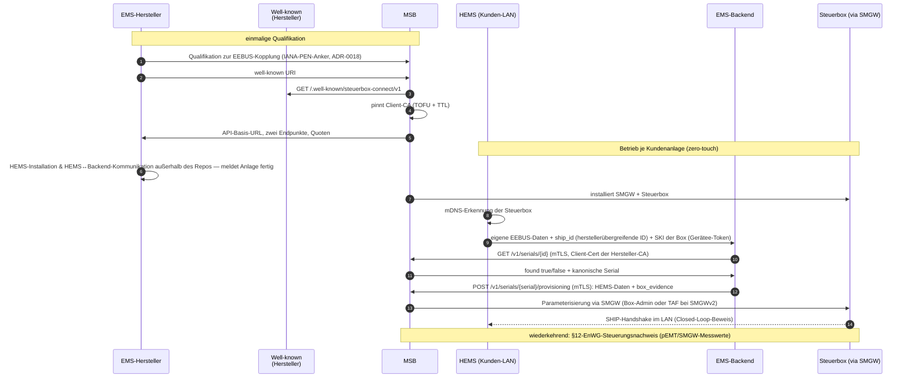

# Der Prozess in 10 Schritten

Der vollständige bilaterale Ablauf von der einmaligen Qualifikation bis zum
regelmäßigen Steuerungsnachweis. Schritte 1–3 und 7–8 sind die Backend-zu-Backend-Schiene,
die dieses Repo implementiert und testet; die übrigen Schritte sind Prozesskontext der
Beteiligten.

## Die Schritte im Detail

1. **Qualifikation (einmalig pro Hersteller):** MSB und EMS-Hersteller führen die bilaterale
   Qualifikation zur EEBUS-Kopplung und -Steuerung durch (IANA PEN als Anker, ADR-0018). Der
   Hersteller teilt seine well-known URI mit, der MSB seine API-Basis-URL samt der beiden
   Endpunkte und Quoten.
2. **Well-known des EMS-Herstellers:** Der Hersteller stellt den
   `/.well-known/steuerbox-connect/v1`-Endpunkt bereit und veröffentlicht darin seine
   dedizierte Client-CA.
3. **MSB-API:** Der MSB stellt seine API-Basis-URL und zwei mTLS-Endpunkte bereit: die
   Serial-/ID-Abfrage (`GET /v1/serials/{serial|vpid}`) und die Übermittlung der EEBUS-Daten
   (`POST /v1/serials/{serial}/provisioning`).
4. **Installation HEMS:** Der EMS-Hersteller installiert seine Geräte (außerhalb dieses
   Repos) und meldet die Kundenanlage fertig über den Installateursbetrieb.
5. **Installation MSB:** Der MSB installiert SMGW und Steuerbox.
6. **LAN-Erkennung:** Das EMS erkennt automatisch im Kundennetzwerk die Steuerbox (mDNS) und
   meldet dem EMS-Backend — authentifiziert mit Gerätee-Token (Verfahren des Herstellers,
   z.B. JWT; außerhalb dieses Repos) — seine eigenen EEBUS-Daten
   sowie ship_id (enthält die herstellerübergreifende ID) und SKI der erkannten Steuerbox.
7. **Discovery:** Das EMS-Backend fragt den ersten mTLS-Endpunkt ab, ob die
   herstellerübergreifende ID zu diesem MSB gehört.
8. **Provisionierung:** Beim gefundenen MSB übermittelt das Backend über den zweiten
   mTLS-Endpunkt die EEBUS-Daten des EMS: ship_id, SKI und den SHIP-Info-Datensatz
  inkl. SPSEC-Secret (mTLS ist sein Transport, ADR-0017) — Serial/FPH/base-URI
  entfallen (Serial steckt in ship_id, FPH im Datensatz, base-URI aus der
  Qualifikation) — sowie ship_id und SKI der erkannten Steuerbox (`box_evidence`).
9. **Parameterisierung:** Der MSB parametriert über das SMGW die Steuerbox — über den
   Steuerbox-Admin oder bei Nutzung von SMGWv2 via TAF am SMGW — mit den Daten des EMS und
   richtet die Steuerung über EEBUS ein.
10. **Nachweis:** Regelmäßiger Test nach §12 EnWG für den Steuerungsnachweis durch den MSB in
    Kombination mit pEMT-/SMGW-Messwert-Auswertung.

## Invarianten, die in jedem Schritt gelten

- **Beide MSB-Endpunkte sind mTLS-only** — kein anonymer Modus, keine Bypass-Flags.
- **Tri-State:** Transportfehler ist `unknown`, niemals `404`.
- **Write-once:** Serial↔MSB ändert sich nie (MSB-Wechsel = physischer Box-Tausch).
- **Write nur auf kanonischer Serial** (Regel-S-Basis der Discovery-Query).
- **Idempotenz:** Provisionierung ist idempotent auf `(serial, ship_id)`.
- **Closed Loop:** Nur der akzeptierte SHIP-Handshake im LAN beweist, dass der Write die
  physische Box erreicht hat; `202 Accepted` allein beweist nichts.

Details zu Matching-Regeln: [Spezifikation](spec/index.md) ·
Vertrauensmodell: [Sicherheit & Trust](security.md).